# Garmin Dashboard

A private dashboard for your Garmin Connect data that opens on any phone.

- **Yours alone.** Your Garmin login is stored in your own free GitHub account, and your data is encrypted with a passphrase only you know.
- **Automatic.** New data is downloaded from Garmin every day.
- **Free.** No app store or subscription.

---

## 1. Set it up (about 5 minutes, on your phone)

Open the setup page and follow the boxes:

**👉 https://matrobinson1993.github.io/garmin-dashboard/setup.html**

You'll need a free GitHub account ([sign up](https://github.com/signup)).

| **Step 1: Connect GitHub** | **Step 2: Garmin login and passphrase** |
|:---:|:---:|
| 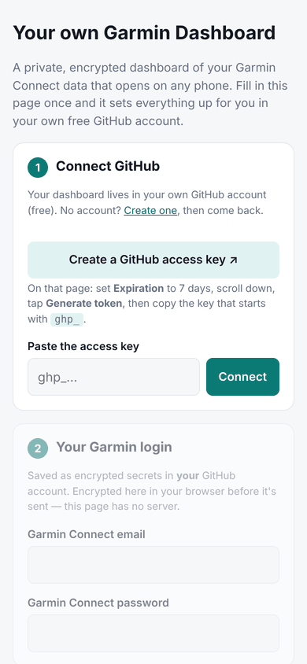 | 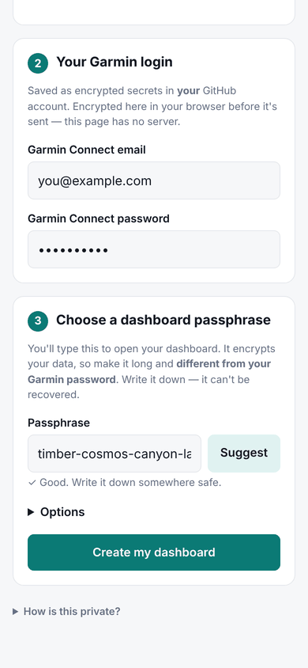 |
| Tap **Create a GitHub access key**, set *Expiration* to 7 days, tap **Generate token**, copy the key (starts with `ghp_`) and paste it in. | Enter your Garmin Connect email and password. Tap **Suggest** for a passphrase and **write it down**. You'll need it to open your dashboard. |

| **Step 3: Verification code (if asked)** | **Step 4: Done** |
|:---:|:---:|
| 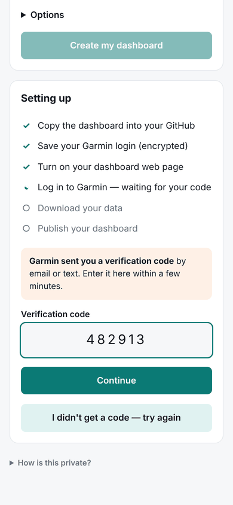 | 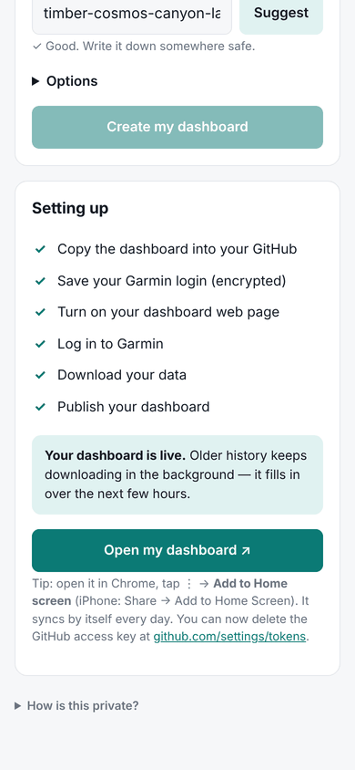 |
| If you use 2-step verification, Garmin emails or texts you a code. Type it in within a few minutes. | Tap **Open my dashboard**. Older history keeps downloading in the background for a few hours. |

---

## 2. Open your dashboard

| **Unlock** | **Overview** |
|:---:|:---:|
| 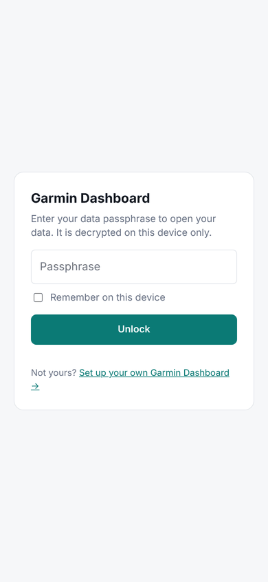 | 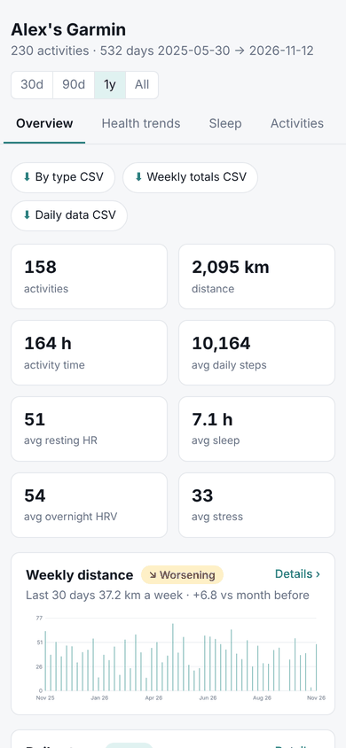 |
| Enter your passphrase. Tick *Remember on this device* so you don't have to type it each time. | Totals, trends and charts for the last 30 days, 90 days, 1 year or all time. |

**Make it an app:** in Chrome, tap **⋮ → Install app** (iPhone Safari: **Share → Add to Home Screen**).

---

## 3. What's inside

| **Health trends** | **Tap any chart for detail** |
|:---:|:---:|
| 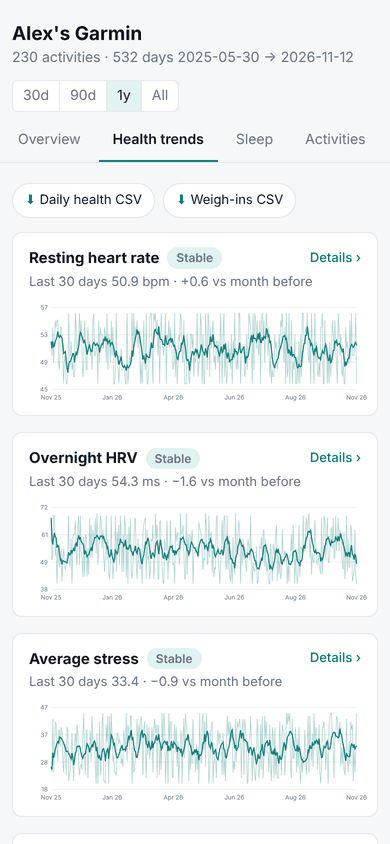 | 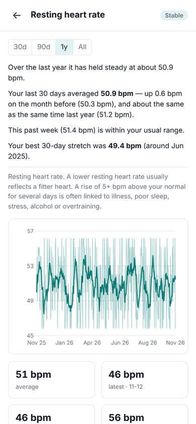 |
| Resting heart rate, HRV, stress, Body Battery, sleep, VO₂ max, weight and more. Each one is marked *Improving*, *Worsening* or *Stable*. | A plain-English summary: which way it's heading, this month compared with last month and last year, and your best stretch. |

| **Records** | **Activity trends and heart rate zones** |
|:---:|:---:|
| 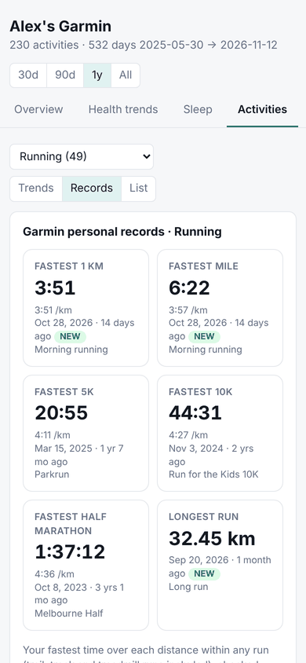 | 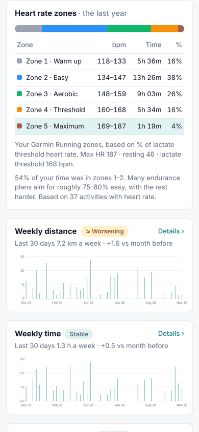 |
| Your fastest 1 km, mile, 5K, 10K, half and full marathon, with dates, and your top 5 at each distance. | Pace, heart rate, efficiency and training load for each activity type, plus time in each heart rate zone (with your bpm ranges). |

| **More** |
|:---:|
| 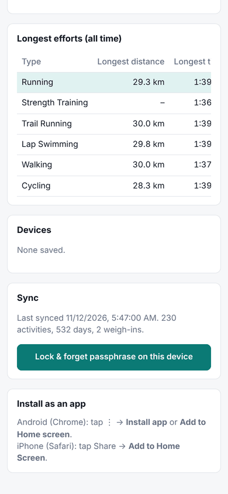 |
| Download everything as CSV or JSON, check when it last synced, or install it as an app. |

---

## Good to know

- **Syncing:** it syncs every morning. To sync now, open your repository on GitHub, then **Actions → Sync Garmin data → Run workflow**. The **More** tab links there.
- **Updates are automatic:** each daily sync uses the latest version of the dashboard, so new features and fixes reach you within a day. To turn this off, add a variable called `AUTO_UPDATE` with the value `false` in your repository (**Settings → Secrets and variables → Actions → Variables**). Your data and settings are never touched by updates.
- **Privacy:** only GitHub sees your Garmin login, and it's stored as a secret in **your** account. The web page is public but your data is encrypted, and it can only be opened with your passphrase. Whoever shared this with you never sees your login or data.
- **Forgot your passphrase?** Set a new `DATA_PASSPHRASE` secret in your repository (**Settings → Secrets and variables → Actions**), then run the sync with **Start over** ticked.
- **Something not working?** Open **Actions** in your repository and tap the latest run. The message at the top says what went wrong.
- **Unofficial:** this uses Garmin's unofficial access through the [`garminconnect`](https://pypi.org/project/garminconnect/) library. It isn't made or endorsed by Garmin.

<b>Manual setup (without the setup page)</b>

1. On this repository, tap **Use this template → Create a new repository**. Keep it **Public**.
2. **Settings → Pages:** set *Source* to **GitHub Actions**.
3. **Settings → Secrets and variables → Actions:** add `GARMIN_EMAIL`, `GARMIN_PASSWORD` and `DATA_PASSPHRASE`.
4. **Actions → Sync Garmin data → Run workflow.** If it asks for a verification code, run it again and paste the code in.
5. Open `https://YOUR-USERNAME.github.io/YOUR-REPO-NAME/`.

